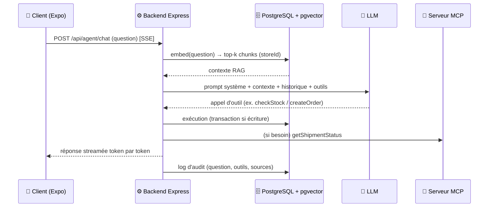
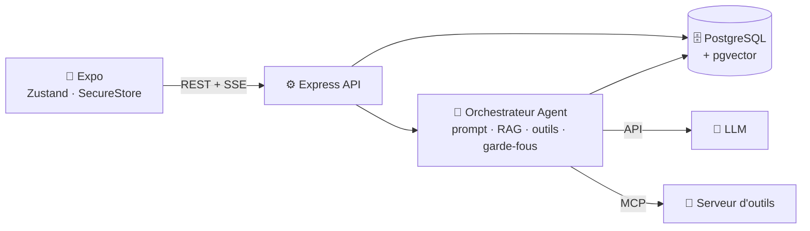
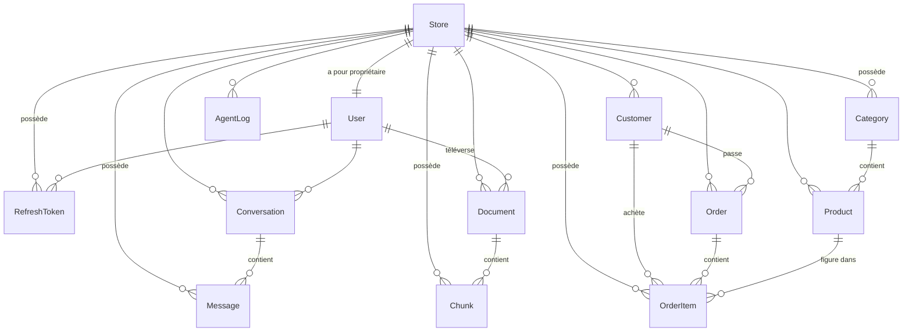

<h1 align="center">🛍️ ShopMate AI</h1>

<p align="center">
  <strong>Assistant conversationnel IA pour boutique e-commerce en paiement à la livraison (COD)</strong><br>
  Application mobile multi-tenant — RAG · Function Calling · MCP
</p>

<p align="center">
  <a href="https://skillicons.dev">
    
  </a>
</p>

<p align="center">
  
  
  
  
</p>

---

## 📑 Sommaire

- [À propos](#-à-propos)
- [Le problème](#-le-problème)
- [La solution](#-la-solution)
- [Fonctionnalités](#-fonctionnalités)
- [Comment fonctionne l'agent IA](#-comment-fonctionne-lagent-ia)
- [Les outils de l'agent](#-les-outils-de-lagent-function-calling)
- [Ce que l'agent refuse](#-ce-que-lagent-refuse-garde-fous)
- [Stack technique](#-stack-technique)
- [Architecture](#-architecture)
- [Modèle de données](#-modèle-de-données)
- [Associations et isolation multi-tenant](#associations-et-isolation-multi-tenant)
- [Démarrage rapide](#-démarrage-rapide)
- [Variables d'environnement](#-variables-denvironnement)
- [API REST](#-api-rest)
- [Exemple de conversation](#-exemple-de-conversation)
- [Sécurité](#-sécurité)
- [Déploiement](#-déploiement)
- [Feuille de route](#-feuille-de-route)
- [Auteur](#-auteur)

---

## 🎯 À propos

**ShopMate AI** est une application mobile de boutique en ligne dans laquelle un **assistant conversationnel intelligent est la fonctionnalité centrale**, pas un simple ajout.

Le client discute en langage naturel (français ou darija) : il pose ses questions sur les produits, la livraison ou les retours, **passe sa commande et la suit** — sans qu'aucun humain n'intervienne, 24h/24.

L'application est **multi-tenant** : chaque donnée est rattachée à un `storeId`, donc une même instance peut servir plusieurs boutiques. Le projet est ainsi extensible en véritable produit SaaS.

### Dernière mise à jour

- **Parcours d'Achat Intégré dans le Chat & Cartes Interactives (`mobile/app/(tabs)/chat.tsx`) :**
  - **Cartes produits cliquables :** Les résultats de recherche de l'agent (`searchProducts`) sont rendus sous forme de carrousel de cartes produit interactives avec nom, catégorie, pastille de stock en direct (*"En stock"* / *"Rupture"*) et prix en DH, avec redirection directe vers la fiche produit [`/product/[id]`](file:///c:/Users/User/Desktop/full%20roge%20projcted%20ccfbs/Shopmates.Ai/mobile/app/product/%5Bid%5D.tsx).
  - **Carte de récapitulatif avec confirmation explicite :** Lorsque l'agent prépare une commande (`createOrder`), il génère une carte de prévisualisation avec le détail des articles, l'adresse et le montant total COD. Deux boutons interactifs permettent de valider (**« ✅ Confirmer la commande »** qui envoie *"Oui"*) ou d'annuler (**« Non, annuler »**), garantissant qu'aucune écriture en base n'a lieu avant le consentement explicite du client.
  - **Carte de commande créée :** Dès que la commande est enregistrée dans PostgreSQL, une carte de succès verte s'affiche avec le numéro de commande (`Commande #1234`) et un bouton direct **« 📦 Voir ma commande ➔ »** redirigeant vers l'écran de suivi [`/orders`](file:///c:/Users/User/Desktop/full%20roge%20projcted%20ccfbs/Shopmates.Ai/mobile/app/%28tabs%29/orders.tsx).
  - **Citations documentaires RAG :** Affichage soigné des sources vérifiées (`📄 politique-livraison.md (84%)`) sous les réponses de l'agent pour une traçabilité et une transparence totale.
  - **Flux d'achat conversationnel complet :** Recherche de produit ➔ consultation de la fiche ➔ récapitulatif ➔ confirmation ➔ commande validée, le tout directement au sein du chat mobile.
- **Streaming SSE temps réel & Persistance de l'historique (`POST /api/agent/chat` & `GET /api/agent/conversations`) :**
  - **Streaming SSE token par token :** Support complet de `text/event-stream` avec flush immédiat des headers (`res.flushHeaders()`) et neutralisation du buffering proxy (`X-Accel-Buffering: no`).
  - **Protocole d'événements typés :** Émission en temps réel des événements `start` (id conversation), `source` (chunks RAG avec similarités), `tool_call` & `tool_result` (télémétrie des outils), `token` (morceaux de réponse), `confirmation` (état de commande COD), `done` (bilan final) et `error`.
  - **Gestion proactive de la déconnexion client :** Détection de la fermeture de connexion via `req.on("close")` déclenchant `AbortController.abort()` sur l'appel LLM pour interrompre immédiatement la consommation de tokens.
  - **Rate limiting par utilisateur :** Middleware `agentRateLimiter` limitant chaque utilisateur authentifié à **20 messages par minute** (protection anti-abus et maîtrise des coûts).
  - **Persistance en base de données :** Enregistrement automatique des conversations (`Conversation`) et des messages (`Message`), avec ordonnancement chronologique des échanges et isolation stricte par `storeId`.
  - **Endpoints d'historique :** `GET /api/agent/conversations` (liste des conversations avec messages ordonnés) et `GET /api/agent/conversations/:id` (détail d'une conversation).
- **Écran de Chat Mobile avec client SSE autonome (`mobile/app/(tabs)/chat.tsx` & `mobile/src/api/agentChat.ts`) :**
  - **Client SSE Expo / React Native :** Implémentation basée sur `XMLHttpRequest` (`onprogress` / `readyState === 3`) sans dépendances natives externes (compatible Expo Go et Android/iOS/Web).
  - **Rendu progressif token par token :** Affichage fluide et dynamique de la réponse au fil de l'eau avec auto-scroll automatique vers le bas.
  - **Télémétrie en direct de l'agent :** Indicateurs contextuels (*"🔍 Consultation du catalogue..."*, *"📦 Accès aux commandes..."*).
  - **Citations de sources RAG :** Badges cliquables affichant le nom du document source et son score de confiance.
  - **Gestion des erreurs & réessai :** Prise en charge des déconnexions et du rate limit HTTP 429 avec bandeau d'alerte et bouton **"🔄 Réessayer"**.
  - **Arrêt à la demande :** Bouton **"Arrêter"** dans le header et annulation automatique du flux au démontage du composant (`useEffect` cleanup).
- **Journal d'audit IA Admin (`mobile/app/(tabs)/admin-agent-logs.tsx`, `GET /api/agent/logs`) :**
  - **Accès réservé au gérant :** L'entrée est visible uniquement pour le rôle `ADMIN`; l'API vérifie aussi ce rôle et filtre chaque requête par le `storeId` issu du JWT.
  - **Recherche paginée et filtres :** Filtrer par client (`customerId`, identifiant du compte client), période (`fromDate` / `toDate`, format `YYYY-MM-DD`) et résultat (`refused` ou `blocked`).
  - **Détail d'un tour :** `GET /api/agent/logs/:id` retourne la question, la réponse, les outils appelés et leurs arguments validés, les sources RAG, les tokens d'entrée/sortie/total, la latence, le statut et la catégorie de refus ou blocage.
  - **Protection des données :** Les traces affichées sont celles de la boutique authentifiée; les secrets, mots de passe et jetons sont masqués avant leur enregistrement.
- **Function Calling — 8 outils agent + Validation Zod + Confirmation explicite (`src/services/agentTools.ts`, `src/services/orderConfirmation.ts`) :**
  - **Allowlist stricte :** Seuls les 8 outils autorisés (`searchProducts`, `getProductDetails`, `checkStock`, `createOrder`, `getOrderStatus`, `listMyOrders`, `cancelOrder`, `getShipmentStatus`) sont acceptés ; tout appel d'outil inconnu est rejeté avec un message d'erreur sûr.
  - **Validation Zod systématique :** Chaque appel d'outil est validé contre un schéma Zod avant exécution ; les arguments malformés ou manquants déclenchent un refus explicite.
  - **Injection serveur-side :** `storeId` et `userId` sont toujours injectés depuis le JWT — jamais acceptés depuis la sortie du modèle. Toute valeur `storeId`/`customerId` dans les arguments du modèle est supprimée avant validation.
  - **5 outils de lecture implémentés :** `searchProducts` (catalogue scopé), `getProductDetails`, `checkStock` (stock et prix depuis la BDD en direct, zéro hallucination), `getOrderStatus` et `listMyOrders` (isolation stricte par client authentifié).
  - **Flux de confirmation 2 étapes pour les écritures :** `createOrder` et `cancelOrder` produisent d'abord un récapitulatif complet (produit, quantité, prix, adresse, COD) **sans aucune écriture en base**, stocké avec un token de confirmation lié à la conversation. L'écriture réelle n'a lieu qu'après un « Oui » explicite du client.
  - **Transaction ACID + verrou pessimiste :** L'exécution confirmée se fait dans une transaction Sequelize avec `LOCK.UPDATE` sur les lignes de stock — impossible de sur-vendre même en cas de requêtes concurrentes.
  - **Idempotence :** En cas de retry, si l'action a déjà été exécutée, le résultat mis en cache est retourné directement — aucun doublon de commande possible.
  - **Max 3 appels d'outils par tour :** Limite configurable pour éviter les boucles coûteuses.
  - **Scripts de test :** `npm run test:tools`, `npm run test:read-tools`, `npm run test:confirmation` valident les scénarios nominal, erreur et idempotence.
- **Client LLM Provider-Agnostique & Agent Conversationnel (`src/services/llm.ts` + `POST /api/agent/chat`) :**
  - **Provider-agnostique complet :** Piloté dynamiquement par `LLM_API_KEY`, `LLM_MODEL` et `LLM_BASE_URL` (compatible OpenAI `gpt-4o-mini`, Claude via OpenRouter/proxy, et DeepSeek `deepseek-chat` sans modification de code).
  - **Streaming temps réel & Tool-Calling :** Support du streaming en Server-Sent Events (`text/event-stream`) avec accumulation et gestion des appels d'outils (`onToolCalls`).
  - **Prompt système avec garde-fous stricts :** Rôle conseiller de vente ShopMate, détection automatique Français/Darija, réponses basées RAG avec citation des sources `(source : ...)`, séparation stricte (stock/prix direct depuis la base), règles de refus obligatoires (remises, prix, remboursements directs, conseils juridiques/médicaux).
  - **Sécurité & Résilience :** Protection contre les injections de prompt (documents = données pures), limite de tokens (`1024`), timeout strict (30s) et retries automatiques sur erreurs réseau / 5xx.
  - **Script de test & Validation :** Commande `npm run test:llm` (`src/scripts/test-llm.ts`) validant les 6 garde-fous du prompt système et exécutant un appel de test avec réponse streamée token par token.
  - **Traçabilité :** Journalisation de chaque interaction dans `AgentLog` (modèle utilisé, statut, message utilisateur et assistant sans fuite de secrets).
  - **Écran Chat Mobile (`mobile/app/(tabs)/chat.tsx`) :** Interface conversationnelle complète avec suggestions rapides, bulles de messages stylisées (utilisateur/assistant), intégration API `/api/agent/chat`, et affichage de l'état de chargement.
- **Pipeline RAG — Ingestion de documents (`src/services/rag.ts` + `POST /api/documents`) :**
  - Upload de fichiers `.md`/`.txt` via `multipart/form-data` (Multer, max 2 Mo, ADMIN uniquement).
  - Découpage en chunks de ~800 caractères avec chevauchement de 100 caractères, en respectant les frontières de paragraphes, de lignes et d'espaces.
  - Génération d'embeddings 1536 dimensions en batch via **OpenAI `text-embedding-3-small`** (DeepSeek ne dispose pas d'endpoint d'embedding).
  - Insertion atomique de tous les chunks avec leur vecteur dans pgvector (`VECTOR(1536)`) dans une seule transaction Sequelize.
  - Re-ingestion (`PUT /api/documents/:id/reingest`) : suppression atomique des anciens chunks puis recréation complète.
  - Suppression propre (`DELETE /api/documents/:id`) : chunks supprimés avant le document, dans une transaction.
  - Variables d'environnement : `OPENAI_API_KEY`, `EMBEDDING_MODEL`, `DEEPSEEK_API_KEY`, `DEEPSEEK_BASE_URL`.
- **Pipeline RAG — Recherche sémantique (`retrieveContext` + `GET /api/documents/search`) :**
  - Embedding de la question utilisateur avec le même modèle (`text-embedding-3-small`).
  - Requête pgvector avec opérateur de distance cosinus (`<=>`) sur l'index HNSW, toujours filtrée par `storeId` (isolation multi-tenant stricte).
  - Seuil de similarité `0.75` : en dessous, retourne un tableau vide → l'agent répond "Je n'ai pas cette information" (anti-hallucination).
  - Retourne les top 4-6 chunks avec le nom du document source et le score de similarité.
  - Route de test `GET /api/documents/search?q=...` pour valider la récupération depuis Postman.
- **Catalogue Produits Mobile (Écrans Explore & Détail) :**
  - **Écran Catalogue (`mobile/app/(tabs)/index.tsx`) :** Barre de recherche en temps réel, carrousel de filtres par catégorie avec pastilles actives, filtre par fourchette de prix, pagination / défilement infini, gestion des états (chargement squelette/spinner, catalogue vide avec CTA, bannières d'erreur avec rechargement).
  - **Écran Fiche Produit (`mobile/app/product/[id].tsx`) :** Affichage galerie photos, titre, badges de catégorie, prix en Dirhams (DH), description complète, sélecteurs interactifs de tailles/variantes, indicateur de stock en temps réel, et bouton d'action directe pour passer commande.
- **Navigation Mobile & Système de Design (`stitch_shopmate`) :**
  - **Layout à 4 onglets Expo Router :** Navigation fluide et réactive entre **Boutique** (`index`), **Assistant IA** (`chat`), **Commandes** (`orders`), et **Profil** (`profile`), suivant fidèlement les maquettes Figma et le design system.
  - **Tokens de thème & Design System :** Palette complète extraite de `stitch_shopmate/shopmate_ai/DESIGN.md` (terracotta primaire `#9c3e23`, or COD `#F5A623`, surfaces douces `#fff8f6`, typographies Lexend, rayons et espacements).
  - **Composants partagés réutilisables :** `Button`, `Input`, `Card`, `Loader`, `EmptyState`, `ErrorState`.
- **Authentification complète (Backend & Mobile) :**
  - **Backend :** JWT avec rotation de refresh tokens, hachage bcrypt, invalidation immédiate à la déconnexion.
  - **Mobile :** Écrans login/register, persistance `Expo SecureStore`, store Zustand, intercepteur Axios 401 avec mutex anti-concurrence.
- **Catalogue & Catégories, Commandes COD, Documentation & Sécurité :**
  - CRUD produits/catégories (admin), commandes avec transaction ACID, Swagger UI, collection Postman, Helmet, rate limiting.
- **Journal de bord (`docs/journal-de-prompts.md`) :** Documentation continue du vibe coding raisonné, des décisions techniques et des points clés pour la soutenance.


> 🎓 Projet Fil Rouge — *Mobile Augmented AI* · Deadline : **24 octobre 2026**

---

## ❗ Le problème

Une boutique COD (très répandue au Maroc) fait face chaque jour à trois coûts cachés :

| Problème | Conséquence |
|---|---|
| 🔁 **Questions répétitives** — prix, tailles, disponibilité, délai et frais de livraison, retours | Le vendeur répond 100 fois par jour la même chose |
| 🌙 **Demandes hors horaires** — le soir et le week-end | Les ventes non traitées dans l'heure sont perdues |
| 📞 **Prise de commande manuelle** par téléphone | Temps perdu, erreurs de saisie, aucune traçabilité |

---

## 💡 La solution

ShopMate AI automatise **les deux tâches à la fois** :

1. **Répondre** — l'assistant puise dans les documents réels de la boutique (RAG), il n'invente pas.
2. **Agir** — l'assistant exécute de vraies opérations métier (function calling), toujours avec confirmation avant une écriture.

---

## ✨ Fonctionnalités

### Pour le client
- 🔐 Inscription, connexion, session sécurisée (JWT + refresh rotatif)
- 🛒 Catalogue produits avec recherche, filtres et fiche détaillée
- 💬 **Chat avec l'assistant IA**, réponse affichée mot par mot (streaming SSE)
- 📦 Passer une commande COD **directement dans la conversation**
- 🚚 Suivre l'état de sa commande et sa livraison
- 🗂️ Historique des conversations conservé

### Pour le gérant
- 📋 Gestion du catalogue (produits, catégories, stock, prix)
- 📄 Dépôt des documents de connaissance (FAQ, livraison, retours, guide des tailles)
- 🔍 Journal d'audit : chaque question, chaque outil appelé, chaque source citée
- 🏪 Isolation totale entre boutiques (`storeId`)

---

## 🧠 Comment fonctionne l'agent IA

L'agent combine **deux mécanismes volontairement séparés**. C'est le cœur du projet.

| | 📚 **RAG** — le savoir | ⚡ **Function Calling** — l'action |
|---|---|---|
| **Rôle** | Répondre à une question | Exécuter une opération réelle |
| **Source** | Documents vectorisés de la boutique | Base de données en direct |
| **Exemple** | « Vous livrez à Casablanca ? » | « Je la veux » → crée la commande |
| **Fraîcheur** | Statique (mise à jour par l'admin) | Temps réel |
| **Garde-fou** | Refus si aucun document pertinent | Confirmation avant toute écriture |

> **La règle simple : RAG = savoir. Function calling = faire.**

### Le pipeline RAG en 5 étapes

```
Document  →  Découpage (~800 car.)  →  Embedding (1536 dim.)  →  pgvector
                                                                     ↓
Réponse citée  ←  LLM + contexte  ←  Top 4–6 chunks (cosinus, HNSW, filtré par storeId)
```

### Le flux complet d'un message



---

## 🔧 Les outils de l'agent (function calling)

| Outil | Rôle | Confirmation | Endpoint |
|---|---|:---:|---|
| `searchProducts` | Rechercher des produits (mots-clés, filtres) | ❌ | `GET /api/products` |
| `getProductDetails` | Détail d'un produit | ❌ | `GET /api/products/:id` |
| `checkStock` | Stock et prix **en direct** | ❌ | `GET /api/products/:id/stock` |
| `createOrder` | Créer une commande COD | ✅ **Oui** | `POST /api/orders` |
| `getOrderStatus` | Statut d'une commande | ❌ | `GET /api/orders/:id` |
| `listMyOrders` | Commandes du client courant | ❌ | `GET /api/orders` |
| `cancelOrder` | Annuler une commande | ✅ **Oui** | `POST /api/orders/:id/cancel` |
| `getShipmentStatus` | Suivi transporteur *(via MCP)* | ❌ | Serveur MCP |

> ⚠️ **Le stock et le prix passent TOUJOURS par une fonction.** Ils ne sont jamais générés par le modèle.

---

## 🛡️ Ce que l'agent refuse (garde-fous)

| Risque | Protection mise en place |
|---|---|
| 🌀 **Hallucination** | Réponse fondée uniquement sur le contexte RAG ; si le score de similarité est trop faible → « Je n'ai pas cette information » |
| 💉 **Prompt injection** | Documents et résultats d'outils traités comme des **données**, jamais comme des instructions |
| ✍️ **Écriture non désirée** | Allowlist d'outils + validation Zod + confirmation explicite + transaction |
| 🏪 **Fuite entre boutiques** | `storeId` injecté côté serveur depuis le token, jamais accepté du client |
| 👤 **Accès aux données d'autrui** | L'agent ne lit que les commandes du client authentifié |
| 💸 **Abus / coût** | Rate limiting, plafond de tokens, max 3 appels d'outils par tour |

L'agent **refuse systématiquement** : modifier un prix, accorder une remise ou un remboursement, agir sur la commande d'un autre client, donner un conseil médical/juridique, sortir du domaine de la boutique.

---

## 🛠️ Stack technique

| Couche | Technologies |
|---|---|
| **Mobile** | React Native · Expo · Expo Router · Zustand · Axios · Expo SecureStore |
| **Backend** | Node.js · Express · TypeScript · architecture MVC/Clean |
| **Base de données** | PostgreSQL 16 · extension **pgvector** · ORM Sequelize |
| **IA** | API LLM (Claude / OpenAI) · embeddings 1536 dim. · function calling · streaming SSE |
| **Interopérabilité** | **MCP** (Model Context Protocol) · n8n *(bonus)* |
| **Sécurité** | JWT · bcrypt · Zod · Helmet · express-rate-limit |
| **Documentation** | Swagger / OpenAPI · Postman |
| **DevOps** | Docker multi-stage · docker-compose · Railway / Render |

---

## 🏗️ Architecture



### Structure du projet

```
shopmate/
├── backend/
│   ├── src/
│   │   ├── config/                    # environnement, base de données, logger
│   │   ├── models/                    # 13 modèles Sequelize (Store, User, Product, Order...)
│   │   ├── routes/                    # routes API Express (ex. products.ts)
│   │   ├── app.ts                     # initialisation Express
│   │   ├── seed.ts                    # script d'insertion des données de test
│   │   └── server.ts                  # démarrage et écoute du serveur
│   ├── migrations/                    # 14 migrations Sequelize
│   ├── sql/                           # scripts SQL additionnels (ex. index HNSW pgvector)
│   ├── docker-compose.yml             # conteneur PostgreSQL + pgvector
│   ├── package.json
│   └── .env.example
├── mobile/                            # Application mobile Expo React Native
│   ├── app/                           # Expo Router
│   │   ├── (auth)/                    # Écrans d'authentification (login, register)
│   │   ├── (tabs)/                    # 4 Onglets principaux (Boutique, Chat, Commandes, Profil)
│   │   └── _layout.tsx                # Layout racine et Route Guards
│   ├── src/
│   │   ├── api/                       # client Axios et intercepteur de rafraîchissement 401
│   │   ├── auth/                      # gestion sécurisée des tokens (Expo SecureStore)
│   │   ├── components/                # composants partagés (Button, Input, Card, Loader, EmptyState, ErrorState)
│   │   ├── stores/                    # stores d'état Zustand (authStore, catalogStore)
│   │   └── theme/                     # tokens graphiques et système de design Figma
│   ├── package.json
│   └── .env.example
├── stitch_shopmate/                   # Maquettes HTML/CSS & Design System de référence
├── docs/                              # cahier des charges, UML, journal de prompts
├── class-diagram.md                   # diagramme de classes
├── AGENTS.md                          # règles de collaboration avec l'IA
└── README.md
```

---

## 🗄️ Modèle de données



Source Mermaid modifiable : [docs/model-relations.mmd](docs/model-relations.mmd).

| Entité | Rôle |
|---|---|
| `Store` | La boutique — **racine du tenant** |
| `User` / `RefreshToken` | Gérant/admin et jetons de session |
| `Category` / `Product` | Le catalogue (nom, description, prix, stock) |
| `Customer` | Le client acheteur (nom, téléphone, adresse) |
| `Order` / `OrderItem` | Les commandes et leurs lignes |
| `Conversation` / `Message` | L'historique du chat *(entités IA)* |
| `Document` / `Chunk` | Documents et morceaux vectorisés — `embedding vector(1536)` |
| `AgentLog` | Journal d'audit des interactions |

> La relation **1—1** relie une boutique à son propriétaire. Les relations **1—N** relient les boutiques et leurs données métier. La relation **N—N** entre `Customer` et `Product` passe par `OrderItem`, qui conserve aussi la commande et le client concernés.

### Associations et isolation multi-tenant

Les associations sont enregistrées dans `backend/src/models/index.ts` :

- **Propriétaire** : `Store.hasOne(User)` et `User.belongsTo(Store)`. Un index unique sur `users.storeId` empêche d'avoir deux propriétaires pour la même boutique.
- **Relations 1—N** : par exemple, une boutique possède plusieurs produits, catégories et commandes; une commande possède plusieurs lignes `OrderItem`.
- **Relation N—N** : `Customer.belongsToMany(Product)` et l'association inverse utilisent `OrderItem` comme table de jonction. `OrderItem.customerId` est rempli par une migration depuis le client de la commande existante.

Chaque modèle métier a un `storeId`. Pour filtrer les requêtes, le helper `forStore` est exporté par `backend/src/models/index.ts` :

```ts
const scopedCustomers = forStore(Customer, authenticatedStoreId);
const customers = await scopedCustomers.findAll();
```

`authenticatedStoreId` doit venir de l'utilisateur authentifié côté serveur, généralement depuis le JWT. Ne le prends jamais depuis le corps ou les paramètres envoyés par le client. Utilise `forStore` pour chaque requête sur un modèle tenant; le helper rejette un identifiant invalide, mais une requête non passée par ce helper n'est pas filtrée automatiquement.

`Chunk.embedding` utilise le type Sequelize `DataTypes.VECTOR(1536)` fourni par `pgvector/sequelize`. La migration crée l'extension et la colonne vectorielle. Le fichier `backend/sql/001_init_pgvector.sql` ajoute l'index HNSW pour la recherche cosinus; applique-le après les migrations si tu veux activer cet index.

---

## 🚀 Démarrage rapide

### Prérequis

- Node.js ≥ 22 (requis par la version installée de `pgvector`)
- Docker et Docker Compose
- PowerShell, Bash ou un terminal équivalent

### 1. Cloner le dépôt

```bash
git clone https://github.com/<ton-user>/shopmate-ai.git
cd shopmate-ai
```

### 2. Configurer le backend

```bash
cd backend
npm install
```

Copie `backend/.env.example` vers `backend/.env`, puis ajoute les variables locales suivantes. Le fichier `.env.example` est actuellement vide.

```powershell
Copy-Item .env.example .env
```

Dans Git Bash ou macOS/Linux, l'équivalent est `cp .env.example .env`.

```dotenv
DB_HOST=localhost
DB_PORT=5432
DB_NAME=shopmate
DB_USER=postgres
DB_PASSWORD=password
PORT=4000
SEED_ADMIN_PASSWORD=
```

Choisis une valeur d'au moins 12 caractères pour `SEED_ADMIN_PASSWORD`. Ces paramètres correspondent au `docker-compose.yml` du backend et sont réservés au développement local. Ne réutilise pas ce mot de passe en production.

### 3. Lancer PostgreSQL et les migrations

Depuis le dossier `backend` :

```bash
docker compose up -d db
docker compose ps
npx --no-install sequelize-cli db:migrate --config src/config/sequelize-cli.js --migrations-path migrations --env development
npx --no-install sequelize-cli db:migrate:status --config src/config/sequelize-cli.js --migrations-path migrations --env development
```

La première commande démarre PostgreSQL avec pgvector. La commande `db:migrate` crée ou met à jour le schéma; la commande `db:migrate:status` doit ensuite afficher chaque migration comme `up`. Les migrations sont la seule méthode prévue pour gérer le schéma : l'application n'utilise pas `sequelize.sync()`.

Pour créer l'index HNSW après les migrations, depuis `backend` :

PowerShell :

```powershell
Get-Content .\sql\001_init_pgvector.sql | docker compose exec -T db psql -U postgres -d shopmate
```

Bash, macOS ou Linux :

```bash
docker compose exec -T db psql -U postgres -d shopmate < sql/001_init_pgvector.sql
```

### 4. Créer les données de démonstration

Après les migrations, et après avoir défini `SEED_ADMIN_PASSWORD` dans `.env` :

```bash
npm run seed
```

Le seed peut être relancé sans dupliquer les enregistrements. Il crée la boutique `ShopMate Demo Store`, l'admin `admin@shopmate-demo.local` avec un mot de passe hashé par bcrypt, 4 catégories, 15 produits avec prix et stock, et 4 documents d'exemple avec leurs chunks texte. Le mot de passe n'est jamais affiché dans la console.

Les documents sont créés au statut `pending` et leurs chunks ont `embedding = null` : le seed fournit le contenu de démonstration, mais ne génère pas d'embeddings. La recherche vectorielle ne trouvera pas ces documents avant l'exécution du pipeline d'embedding.

### 5. Démarrer et vérifier l'API

```bash
npm run dev
```

Le serveur s'authentifie auprès de PostgreSQL avant d'écouter sur le port `PORT`. Vérifie l'API avec `http://localhost:4000/health`, puis récupère le catalogue de démonstration avec `http://localhost:4000/api/products`. Cette route publique ne lit que la boutique fixe `ShopMate Demo Store`; elle n'accepte pas de `storeId` fourni par le client. La documentation `/api/docs` n'est pas encore configurée.

Vérifications supplémentaires, toujours depuis `backend` :

```bash
npx --no-install tsc --noEmit
npx --no-install sequelize-cli db:migrate:status --config src/config/sequelize-cli.js --migrations-path migrations --env development
```

Pour tester une association, charge les modèles depuis `src/models`, puis fais une requête de lecture avec `include`, par exemple `forStore(Customer, storeId).findAll({ include: [{ association: Customer.associations.purchasedProducts }] })`. Tu peux aussi tester `Store.associations.owner`. N'exécute ces vérifications que sur une base locale/de test.

Pour arrêter PostgreSQL sans supprimer ses données : `docker compose stop db`. N'utilise pas `docker compose down -v` sauf si tu veux aussi supprimer le volume de données local.

### 6. Démarrer l'application mobile

Dans un nouveau terminal, depuis la racine du dépôt :

```powershell
Set-Location mobile
Copy-Item .env.example .env
npm install
npx expo start --lan
```

Scanne le QR code avec **Expo Go**. Dans `mobile/.env`, `EXPO_PUBLIC_API_URL` vaut `http://localhost:4000` par défaut. Sur un téléphone physique, remplace `localhost` par l'adresse IPv4 locale de ton ordinateur, par exemple `http://192.168.1.10:4000`; le téléphone et l'ordinateur doivent être sur le même réseau. `localhost` convient à un émulateur qui partage le réseau de développement, pas à un téléphone physique.

Le thème mobile et les composants partagés respectent fidèlement la charte graphique et les maquettes Figma documentées dans `stitch_shopmate/` (couleur primaire terracotta `#9c3e23`, badges dorés COD `#F5A623`, surfaces chaleureuses `#fff8f6`, et typographie Lexend).

---

## 🔑 Variables d'environnement

| Variable | Description | Exemple |
|---|---|---|
| `DB_HOST` | Hôte PostgreSQL | `localhost` |
| `DB_PORT` | Port PostgreSQL | `5432` |
| `DB_NAME` | Nom de la base | `shopmate` |
| `DB_USER` | Utilisateur PostgreSQL | `postgres` |
| `DB_PASSWORD` | Mot de passe PostgreSQL local | `password` |
| `PORT` | Port du backend | `4000` |
| `SEED_ADMIN_PASSWORD` | Mot de passe choisi pour le compte admin seedé (12 caractères min.) | À définir localement |
| `JWT_SECRET` | Clé secrète de signature des jetons d'accès JWT | `une-cle-secrete-aleatoire-tres-longue` |
| `JWT_EXPIRES_IN` | Durée de validité des jetons d'accès | `15m` |
| `CORS_ORIGIN` | Domaines autorisés pour CORS | `http://localhost:8081,http://localhost:19006` |
| `OPENAI_API_KEY` | Clé API OpenAI (utilisée pour générer les embeddings RAG) | `sk-...` |
| `EMBEDDING_MODEL` | Modèle d'embeddings pgvector (1536 dim) | `text-embedding-3-small` |
| `DEEPSEEK_API_KEY` | Clé API DeepSeek pour la génération conversationnelle | `sk-...` |
| `DEEPSEEK_BASE_URL` | URL de base de l'API DeepSeek | `https://api.deepseek.com` |
| `LLM_API_KEY` | Clé d'accès du client LLM provider-agnostique | `sk-...` |
| `LLM_BASE_URL` | Endpoint du provider LLM (optionnel pour OpenAI, requis pour DeepSeek ou proxy Claude) | `https://api.openai.com/v1` *(ou `https://api.deepseek.com`)* |
| `LLM_MODEL` | Modèle de chat utilisé par l'agent | `gpt-4o-mini`, `deepseek-chat`, ou `anthropic/claude-3.5-sonnet` |
| `EXPO_PUBLIC_API_URL` | URL de base de l'API pour l'application mobile Expo | `http://localhost:4000` *(ou IP LAN)* |

> Le fichier `.env` est exclu du contrôle de version (`.gitignore`). Ne commitez jamais de secrets réels. Seul `.env.example` sert de modèle.

---

## 🌐 API REST

### Authentification & Session
| Méthode | Route | Description | Accès |
|---|---|---|---|
| `POST` | `/api/auth/register` | Inscription nouveau compte client | Public |
| `POST` | `/api/auth/login` | Connexion (retourne `accessToken` 15m + `refreshToken` 7j) | Public |
| `POST` | `/api/auth/refresh` | Renouvellement de token avec rotation stricte | Public |
| `POST` | `/api/auth/logout` | Déconnexion avec suppression du refresh token | Public / 🔒 |
| `GET` | `/api/auth/me` | Informations du profil de l'utilisateur connecté | 🔒 Client/Admin |
| `GET` | `/api/auth/admin-only` | Endpoint de vérification du rôle administrateur | 👑 Admin |

### Produits & Catalogue
| Méthode | Route | Description | Accès |
|---|---|---|---|
| `GET` | `/api/products` | Recherche plein texte (`iLike`), filtres (catégorie, prix), pagination | Public démo / 🔒 |
| `GET` | `/api/products/:id` | Fiche détaillée d'un produit avec catégorie associée | Public démo / 🔒 |
| `GET` | `/api/products/:id/stock` | Stock et prix en temps réel (données directes BDD sans hallucination) | Public démo / 🔒 |
| `POST` | `/api/products` | Création de produit (SKU unique, validation Zod) | 👑 Admin |
| `PUT` | `/api/products/:id` | Mise à jour de produit (scopé par `storeId`) | 👑 Admin |
| `DELETE` | `/api/products/:id` | Suppression de produit | 👑 Admin |

### Catégories
| Méthode | Route | Description | Accès |
|---|---|---|---|
| `GET` | `/api/categories` | Liste des catégories de la boutique | Public démo / 🔒 |
| `GET` | `/api/categories/:id` | Détail d'une catégorie | Public démo / 🔒 |
| `POST` | `/api/categories` | Créer une catégorie (nom unique par boutique) | 👑 Admin |
| `PUT` | `/api/categories/:id` | Mettre à jour une catégorie | 👑 Admin |
| `DELETE` | `/api/categories/:id` | Supprimer une catégorie | 👑 Admin |

### Commandes (Paiement à la livraison - COD)
| Méthode | Route | Description | Accès |
|---|---|---|---|
| `GET` | `/api/orders` | Historique des commandes du client connecté | 🔒 Client |
| `GET` | `/api/orders/:id` | Détail d'une commande avec lignes et articles | 🔒 Client |
| `POST` | `/api/orders` | Passer une commande COD (transaction ACID + décrémentation stock) | 🔒 Client |
| `POST` | `/api/orders/:id/cancel` | Annuler une commande en cours | 🔒 Client |

### Documentation & Diagnostic
| Méthode | Route | Description | Accès |
|---|---|---|---|
| `GET` | `/health` | Vérification de l'état du serveur | Public |
| `GET` | `/api/docs` | Interface Swagger UI interactive | Public |
| `GET` | `/api/docs/swagger.json` | Spécification OpenAPI 3.0 au format JSON | Public |

### Assistant IA & RAG (Connaissances & Chat)
| Méthode | Route | Description | Accès |
|---|---|---|---|
| `GET` | `/api/documents` | Lister les documents de connaissances de la boutique | 👑 Admin |
| `POST` | `/api/documents` | Déposer un document RAG (upload .md/.txt, chunking ~800 car., embeddings 1536) | 👑 Admin |
| `PUT` | `/api/documents/:id/reingest` | Ré-ingérer un document (mise à jour du texte et recalcul atomique des vecteurs) | 👑 Admin |
| `DELETE` | `/api/documents/:id` | Supprimer un document et tous ses chunks associés en cascade | 👑 Admin |
| `GET` | `/api/documents/search` | Recherche sémantique cosinus (`q=...`, seuil 0.75, top 4-6 chunks avec scores) | 🔒 Client/Admin |
| `POST` | `/api/agent/chat` | **Parler à l'assistant conversationnel (mode streaming SSE ou JSON)** | 🔒 Client |
| `GET` | `/api/agent/conversations` | Historique des conversations du client connecté | 🔒 Client |
| `GET` | `/api/agent/conversations/:id` | Récupérer une conversation spécifique avec ses messages ordonnés | 🔒 Client |
| `GET` | `/api/agent/logs` | Journal paginé; filtres optionnels `customerId`, `fromDate`, `toDate`, `disposition` (`refused` / `blocked`), `conversationId`, `action`, `status` | 👑 Admin |
| `GET` | `/api/agent/logs/:id` | Trace complète d'un tour avec client, question, réponse, arguments d'outils, sources RAG, tokens, latence et motif de refus/blocage | 👑 Admin |

---

## 💬 Exemple de conversation

```
👤 Client    : Avez-vous cette chaussure en rouge ?
🤖 ShopMate  : [searchProducts] Oui — disponible en rouge, tailles 40 à 44, 249 DH.

👤 Client    : Taille 42, vous livrez à Casablanca ?
🤖 ShopMate  : [checkStock] La taille 42 est en stock.
               [RAG] Livraison gratuite à Casablanca sous 48h, paiement à la livraison.
               (source : politique-livraison.md)

👤 Client    : Je la veux.
🤖 ShopMate  : Je récapitule : chaussure rouge, taille 42, 249 DH,
               livraison Casablanca, paiement à la livraison.
               Je valide la commande ?                    ⟵ aucune écriture en base

👤 Client    : Oui.
🤖 ShopMate  : [createOrder] Commande n° 1234 enregistrée.
               Nous vous appellerons pour confirmation.

👤 Client    : Fais-moi une remise de 50 DH.
🤖 ShopMate  : Je ne peux pas modifier les prix — c'est en dehors de mon rôle.
               Je peux transmettre votre demande au gérant. ⟵ garde-fou
```

---

## 🔒 Sécurité

- ✅ JWT complet : inscription, connexion, **refresh avec rotation**, déconnexion invalidante
- ✅ Mots de passe hachés **bcrypt** — jamais de mot de passe ni de token dans les logs
- ✅ Rôles `ADMIN` / `CUSTOMER` + isolation stricte par `storeId` sur chaque requête
- ✅ Injections SQL bloquées par les requêtes paramétrées de l'ORM
- ✅ Validation **Zod** de toutes les entrées et de tous les arguments d'outils
- ✅ Helmet, CORS restrictif, rate limiting (20 messages agent / min / utilisateur)
- ✅ Secrets par variables d'environnement — jamais commités
- ✅ Journal d'audit : question, outils appelés, sources, latence, tokens

---

## 🐳 Déploiement

```bash
# Tout lancer en local (API + base)
docker compose up --build

# Build de l'image de production seule
docker build -t shopmate-api ./backend
```

Le `Dockerfile` est **multi-stage** (build puis runtime léger). Le `docker-compose.yml` démarre l'image `pgvector/pgvector` et l'API. L'hébergement cible est **Railway** ou **Render**, avec les secrets configurés côté plateforme.

---

## 🗺️ Feuille de route

| Semaine | Contenu | Statut |
|:---:|---|:---:|
| 1 | Cadrage, cahier des charges, UML/ERD, maquettes | 🟢 |
| 2 | PostgreSQL + Sequelize, migrations, seed, pgvector | 🟢 |
| 3 | Authentification JWT complète (Backend + Mobile) | 🟢 |
| 4 | CRUD produits, catégories, commandes COD, Swagger + Postman | 🟢 |
| 5 | Pipeline RAG (ingestion, embeddings 1536 dim, recherche cosinus HNSW) | 🟢 |
| 6 | Function calling (8 outils + validation Zod + confirmation explicite) | 🟢 |
| 7 | Client LLM provider-agnostique (OpenAI/Claude/DeepSeek) & streaming SSE (`POST /api/agent/chat`) | 🟢 |
| 8 | Écran chat mobile React Native / Expo : client SSE streaming, cartes produits cliquables, récapitulatif interactif avec boutons Confirmer/Annuler, citation des sources RAG et suivi de commande | 🟢 |
| 9 | Garde-fous, modération, audit (`AgentLog`) | 🟢 |
| 10 | Serveur MCP + n8n *(bonus)* | ⚪ |
| 11 | Docker + déploiement | ⚪ |
| 12 | Journal de prompts, documentation, soutenance | ⚪ |

🟢 fait · 🟡 en cours · ⚪ à faire

---

## 📚 Documentation du projet

| Document | Contenu |
|---|---|
| `docs/cahier-des-charges.pdf` | Périmètre, 38 besoins fonctionnels, 18 non fonctionnels, critères d'acceptation |
| `docs/conception-uml.md` | Cas d'utilisation, diagramme de classes, séquence, ERD |
| `docs/journal-de-prompts.md` | Vibe coding documenté — livrable évalué (sessions, bugs, décisions) |
| `stitch_shopmate/shopmate_ai/DESIGN.md` | Design System, charte graphique et spécifications UI |
| `http://localhost:4000/api/docs` | Documentation Swagger interactive (disponible en local) |

---

## 👤 Auteur

**Omar Fahid**
Projet Fil Rouge — *Mobile Augmented AI* · 2026

---

## 📄 Licence

Distribué sous licence **MIT**. Voir le fichier `LICENSE`.

---

<p align="center">
  <sub>Construit avec ☕ et beaucoup de prompts documentés.</sub>
</p>
